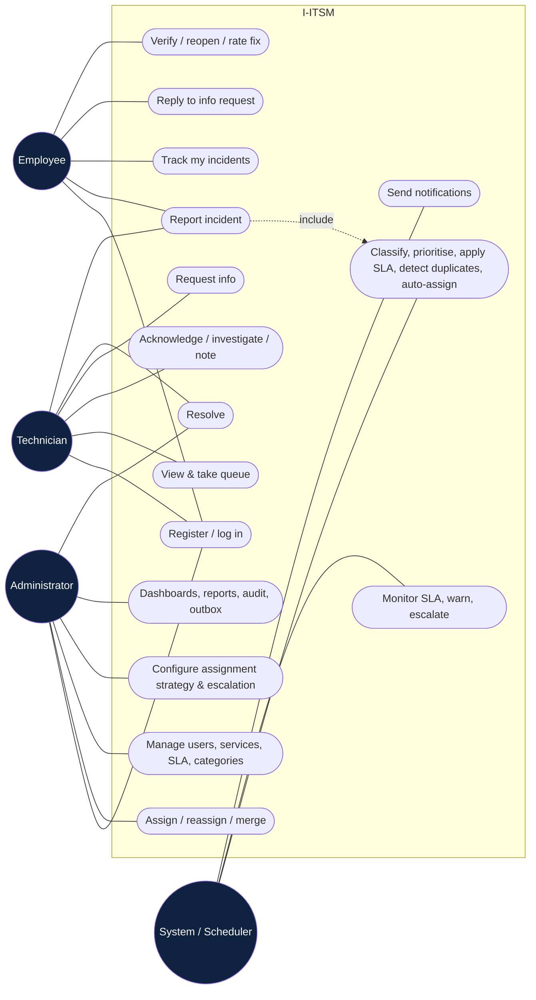
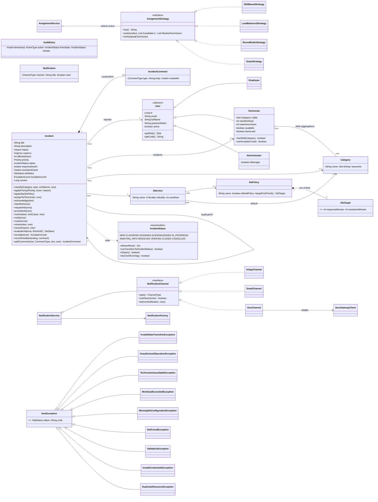
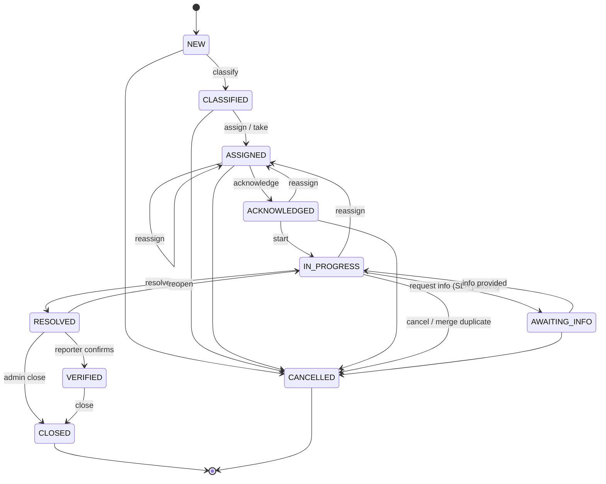
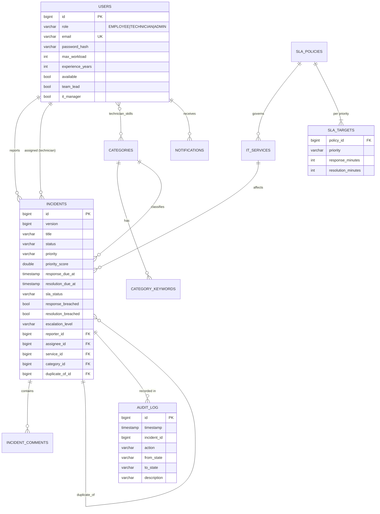

# I-ITSM: Project Report

Intelligent IT Service Management & Incident Resolution System. CS F213 / MAC F212, Semester I 2026-27.

> Mermaid diagrams render on GitHub and in most Markdown viewers. Paste them into https://mermaid.live to export PNG/SVG for the PDF report.

---

## 1. Problem analysis

**Problem.** An organisation depends on dozens of IT services. When one fails, reports arrive by phone, email and chat; nobody knows which are duplicates, which matter most, who should fix them, or whether a deadline is about to be missed. History is scattered, so recurring problems go unnoticed.

**Stakeholders.** Employees (report and track), technicians (investigate and resolve), administrators / IT managers (configure, monitor SLA, staff the team), the organisation (service availability, audit).

**Existing challenges** (from the brief): delayed response, wrong prioritisation, uneven technician load, SLA violations, poor service visibility, duplicate reports, incomplete history, recurring problems.

**Proposed solution.** A web platform where every report is automatically triaged: classified from its text, scored for priority, put on the service's SLA clock, checked for duplicates and routed to the best available technician. A background watchdog warns before deadlines, records breaches and escalates unacknowledged urgent incidents. Every step is an event that is audited, notified and pushed live to dashboards.

**Assumptions.** One organisation (single tenant). Email and SMS delivery are simulated (logged to an outbox), as permitted by the brief. Users authenticate with email + password. Business hours are not modelled; SLA clocks run 24×7 and pause only while waiting on the reporter.

## 2. Requirements

### Functional
| ID | Requirement |
|---|---|
| F1 | Register / log in; three roles with different UIs and permissions |
| F2 | Employees report incidents (service, title, description, impact, urgency, affected users, optional category) |
| F3 | System classifies, prioritises, applies SLA, detects duplicates and assigns automatically |
| F4 | Technicians acknowledge, investigate, add internal notes, request info, resolve |
| F5 | Employees reply to info requests, verify/reopen, give 1-5 feedback; feedback closes the incident |
| F6 | Admins manage users, technicians (skills, capacity), services, SLA policies, categories, assignment strategy |
| F7 | SLA monitoring: warnings at a configurable threshold, breach recording, automatic escalation |
| F8 | Notifications on in-app, email and SMS channels |
| F9 | Complete audit trail per incident and for admin actions |
| F10 | Search with 13 criteria; dashboards and CSV export |

### Non-functional
| ID | Requirement | How it is met |
|---|---|---|
| N1 | Performance | Paginated, index-backed queries; fetch joins (no N+1); ~1,460 req/s measured |
| N2 | Scalability | Stateless JWT API, virtual threads, connection pool, PostgreSQL profile, Docker |
| N3 | Security | BCrypt, JWT, role + ownership checks, validation, login throttling |
| N4 | Reliability | Optimistic locking (`@Version`), transactional audit, async notifications isolated from the request |
| N5 | Usability | Role-specific UIs, live updates, accessible controls (keyboard, focus, AA contrast) |
| N6 | Maintainability | Layered architecture, interfaces + patterns, 30 automated tests, CI |

### Business rules
1. The lifecycle is enforced: e.g. NEW → CLOSED, resolving before investigation, or reopening a closed incident are rejected.
2. Priority = Impact × Urgency × Criticality × user multiplier (section 6).
3. Deadlines = creation time + SLA target for (service policy, priority); time spent waiting on the reporter is added back.
4. A technician never exceeds their maximum concurrent workload, and unavailable technicians receive no work.
5. Employees see and act only on their own incidents; internal notes are hidden from them.
6. Unacknowledged P1/P2 incidents escalate one level per elapsed response window: Technician → Team lead → System admin → IT manager.
7. Duplicates of an open incident are linked to the root and routed to the same technician.

## 3. System architecture

```mermaid
flowchart TB
  subgraph Client["Browser: React SPA"]
    EP[Employee portal]:::c
    TW[Technician workspace]:::c
    AC[Admin console]:::c
  end
  subgraph Server["Spring Boot application (single deployable jar)"]
    SEC[Security filter chain<br/>JWT + roles]
    CTRL[REST controllers<br/>/api/**]
    SSE[LiveEventHub<br/>Server-Sent Events]
    SVC[Application services<br/>IncidentService, AdminService, ReportService]
    DOM[Domain model<br/>Incident, IncidentStatus, User hierarchy, SlaPolicy]
    INT[Intelligence<br/>PriorityEngine, Classifier, Similarity, SLA risk, Correlation]
    ASG[Assignment strategies]
    EVT{{Spring events<br/>IncidentEvent}}
    AUD[AuditTrailListener]
    NOT[NotificationService<br/>InApp / Email / SMS channels]
    MON[SlaMonitor<br/>@Scheduled]
    REPO[Spring Data repositories]
  end
  DB[(H2 / PostgreSQL)]
  Client -- "HTTPS JSON (Bearer JWT)" --> SEC --> CTRL --> SVC
  Client -- "EventSource" --> SSE
  SVC --> DOM
  SVC --> INT
  SVC --> ASG
  SVC -- publish --> EVT
  MON -- publish --> EVT
  EVT --> AUD
  EVT -- after commit, async --> NOT
  EVT -- after commit, async --> SSE
  NOT --> SSE
  SVC --> REPO
  AUD --> REPO
  REPO --> DB
  classDef c fill:#e8eefc,stroke:#1f4fd1
```

**Layers.** Presentation (React) → API (controllers, DTO records, validation, exception mapping) → application services (transactions, orchestration) → domain (entities with behaviour and invariants) → repositories → database. Cross-cutting concerns (audit, notification, live push) hang off domain events, so the core flow knows nothing about them.

**Why this architecture.** A modular monolith keeps one transaction boundary for an incident and its audit trail, is simple to run for a campus team, and still scales horizontally because the API is stateless. Event-driven observers give the decoupling of microservices without the network overhead; any observer could later move behind a message broker.

## 4. UML

### 4.1 Use case diagram



### 4.2 Class diagram (domain + key collaborators)



### 4.3 Incident state machine



## 5. Object-oriented design

| Concept | Where |
|---|---|
| **Encapsulation** | Entities expose no setters for lifecycle fields; state changes only through intention-revealing methods (`Incident.resolve`, `assignTo`…) that enforce invariants. Collections are returned unmodifiable. |
| **Abstraction** | `User` (abstract), `ItsmException` (abstract), `AssignmentStrategy`, `NotificationChannel`; services hide orchestration behind one call (`IncidentService.create`). |
| **Inheritance** (true is-a only) | `Employee`/`Technician`/`Administrator` extend `User`; nine exceptions extend `ItsmException`. |
| **Polymorphism** | `User.getRole()`; four interchangeable `AssignmentStrategy` implementations; three `NotificationChannel`s; each `IncidentStatus` constant overrides `allowedNext()`/`isOpen()`. |
| **Interfaces** | `AssignmentStrategy`, `NotificationChannel`, Spring Data repository interfaces. |
| **Composition** | `Incident` owns its `IncidentComment`s (cascade + orphan removal); `SlaPolicy` owns its `SlaTarget` value objects. |
| **Aggregation** | `Technician` ↔ `Category` skills (categories outlive technicians). |
| **Association** | `Incident` → reporter, assignee, service, category, duplicate root. |
| **Exception handling** | Custom hierarchy mapped to RFC 7807 responses with stable `code`s; DB failure → 503, concurrent edit → 409, validation → 400 with per-field messages. |
| **Collections** | `EnumMap` for SLA targets and channel routing, `EnumSet` for state sets, `ConcurrentHashMap` for settings cache / login throttle, `CopyOnWriteArrayList` for SSE subscribers (read-heavy), `LinkedHashSet` for ordered keywords. |

### Design patterns (8)
| Pattern | Classes | Why |
|---|---|---|
| **State** | `IncidentStatus` (constant-specific behaviour) used by `Incident` | Legal transitions and per-state behaviour live with the state; adding a state is one constant. |
| **Strategy** | `AssignmentStrategy` + 4 implementations, chosen at runtime by `AssignmentService` | Admins switch algorithms without redeploying. |
| **Observer** | `IncidentEvent` published by services; `AuditTrailListener`, `NotificationService`, `LiveEventHub` observe | Audit/notifications/live push added without touching the business flow. |
| **Factory** | `UserFactory` (role → subclass, always hashes password), `NotificationFactory` (event + channel → message) | Creation logic in one place. |
| **Adapter** | `SmsChannel` adapts third-party-style `SmsGatewayClient` to `NotificationChannel` | Swap in a real provider SDK without changing callers. |
| **Repository** | Spring Data interfaces | Persistence behind collection-like interfaces; DB swappable (H2 ↔ PostgreSQL). |
| **Template-ish command table** | `IncidentAction` enum (who + when predicates) | One table drives API authorisation *and* which buttons the UI shows. |
| **Value object** | `SlaTarget`, DTO records | Immutable, validated on construction. |

## 6. Intelligent features (7)

1. **Weighted priority** (`PriorityEngine`): `score = Impact(1-4) × Urgency(1-4) × Criticality(1-5) × users` where users multiplier = 1.0 (≤10), 1.25 (≤100), 1.5 (≤1000), 1.75 (>1000). P1 ≥ 36, P2 ≥ 18, P3 ≥ 8, else P4. Override: organisation-wide impact on a mission-critical service is always P1. Rationale: multiplication keeps an incident low if *any* axis is low (one user on a critical service is not P1), while blast radius can lift it one band. The explanation string is stored and shown.
2. **Auto-categorisation** (`CategoryClassifier`): keyword scoring over normalised tokens; title matches count double; the service's default category adds a prior; confidence = score / (total + 1). Keywords are admin-editable, so new categories need no code.
3. **Duplicate detection** (`SimilarityService`): cosine similarity of term-frequency vectors after stop-word removal, synonym mapping ("unavailable", "down" → outage; "unable", "error" → fail) and light stemming; subject words weigh 2× symptom words; same service adds 0.25. ≥ 0.60 links the incident to the root of its duplicate group.
4. **Correlation / major incident** (`CorrelationEngine`): ≥ 3 open incidents on one service within 30 min raises a major-incident alert; per-service health (Healthy / Degraded / Outage) and duplicate clusters on the dashboard. Correlated reports are routed to the root's technician.
5. **Smart technician recommendation** (`SmartStrategy`): weighted score of skill, spare capacity, experience and past fixes on the same service/category; urgent incidents shift weight to experience.
6. **Predictive SLA risk** (`SlaRiskPredictor`): projects finish time from historical resolution time for the category, the assignee's queue and acknowledgement state; lists incidents likely to breach *before* they do.
7. **Automatic escalation + suggested resolutions**: `SlaMonitor` escalates unacknowledged P1/P2 up the chain; resolved incidents similar to the current one surface their fixes to technicians and, while typing, to reporters.

## 7. Technology selection

1. **Language: Java.** The course's OOP language; strong static typing, mature ecosystem, records/enums/sealed hierarchies express the domain cleanly; virtual threads (JDK 21) give cheap concurrency.
2. **Frontend: React + TypeScript + Vite.** Component model maps to role-specific screens; TypeScript types mirror backend DTOs; TanStack Query handles caching/refetch; Tailwind gives a consistent token-driven design system.
3. **Backend: Spring Boot.** Dependency injection makes the patterns natural (all strategies/channels injected as lists), plus production features: security, validation, transactions, scheduling, events, actuator.
4. **Database: H2 / PostgreSQL.** Relational data with strong relationships and transactional audit needs SQL. H2 runs embedded for zero-setup demos (PostgreSQL compatibility mode); PostgreSQL for production via one profile.
5. **Architecture: layered modular monolith, event-driven internally.** See section 3.
6. **Alternatives considered.** Node/Express (weaker fit for an OOP course, no static types by default), Django (Python, outside course focus), microservices (operational overhead without benefit at this scale), MongoDB (relationships and transactions are central), WebSockets (SSE is simpler for one-way push and works through proxies).
7. **Advantages / limitations.** + One jar, fast startup, typed end to end, testable domain. − In-memory SSE subscribers, settings cache and login throttle are per instance (marked in code); similarity search is in-memory over recent incidents.
8. **Support for OOP.** JPA maps the inheritance hierarchy (single-table), composition (cascade) and value objects (`@Embeddable`); Spring discovers strategy/channel implementations through their interfaces.
9. **Scaling up.** Run N stateless instances behind a load balancer on PostgreSQL; move SSE fan-out, settings cache and throttling to Redis pub/sub; replace in-memory similarity with PostgreSQL full-text or a vector index; read replicas for dashboards; a message broker for notifications.

## 8. Database design



Indexes on incidents: status, priority, created_at, sla_status, service_id, assignee_id, reporter_id; audit_log: incident_id, timestamp; notifications: (recipient_id, channel, read). Schema is generated from the JPA mappings (`ddl-auto=update`). Sample data: `DataSeeder` (12 services, 3 SLA policies, 9 categories, 16 users, ~100 incidents with full history).

## 9. Security

| Concern | Measure |
|---|---|
| Authentication | Email + password → HS256 JWT (8 h), stateless |
| Password protection | BCrypt hashing; policy ≥ 8 chars with letter + digit; never returned by the API |
| Brute force | 5 failed logins per email in 10 min → temporary lock; same message for unknown email and wrong password (no enumeration) |
| Role-based authorisation | URL rules (`/api/admin/**` → ADMIN) + `IncidentAction` who/when table per operation |
| Ownership | Employees can only read/act on incidents they reported; internal notes filtered out |
| Input validation | Bean Validation on every request DTO + domain invariants; sort fields allow-listed; page size capped |
| API hardening | No sessions → no CSRF surface; frame-deny header; errors never leak stack traces |
| Concurrency | Optimistic locking returns 409 on simultaneous edits |

Not implemented (documented): HTTPS termination (deploy behind a TLS proxy), refresh tokens / revocation, MFA.

## 10. Testing

Run: `cd backend && ./mvnw test` → 41 tests, all passing (the 10 HTTP tests run twice: on H2 and on an embedded PostgreSQL, plus one Postgres read-endpoint sweep).

| # | Test | Category |
|---|---|---|
| TC01 | NEW → CLOSED rejected | Business rule / exception |
| TC02 | Full lifecycle NEW → CLOSED, SLA met | Normal operation |
| TC03 | CLOSED/CANCELLED allow no transitions | Business rule |
| TC04 | Resolve without text rejected | Invalid input |
| TC05 | Acknowledge 1 s after response deadline → breach | Boundary |
| TC06 | ON_TRACK → AT_RISK at 75 % → BREACHED after deadline | SLA |
| TC07 | Waiting on reporter extends deadline by paused time | Business rule |
| TC08 | Feedback only after resolution; rating 0/6 rejected | Boundary / invalid input |
| TC09 | SLA policy missing a priority / inverted targets rejected | Exception (missing SLA config) |
| TC10 | Escalation chain caps at IT manager | Boundary |
| TC11 | Blank title / 0 affected users rejected | Invalid input |
| TC12 | Priority bands (P1 outage, P4 nuisance, P2 at score 18) | Algorithm / boundary |
| TC13 | User multiplier lifts P3 → P2 | Boundary |
| TC14 | Payment reports similar; printer report not | Intelligent feature |
| TC15 | Auto-categorisation (VPN → Network, SSO → Authentication) | Intelligent feature |
| TC16 | Skill-based picks skilled, least-loaded | Strategy |
| TC17 | Load-balanced picks lowest utilisation | Strategy |
| TC18 | Round-robin rotates | Strategy |
| TC19 | Smart ranks experienced skilled tech first for P1 | Strategy |
| TC20 | Technician at capacity / unavailable cannot accept | Business rule |
| TC21 | Invalid login → 401 `INVALID_LOGIN` | Exception / security |
| TC22 | No token → 401; employee on admin/dashboard API → 403 | Authorization |
| TC23 | Create pipeline: classified, prioritised, SLA, assigned | Integration |
| TC24 | Missing fields → 400 with per-field errors; unknown service → 404 | Invalid input |
| TC25 | Employee cannot open another's incident → 403 | Authorization |
| TC26 | Resolve before start over API → 409 | Business rule |
| TC27 | Full lifecycle over API incl. info request & feedback; audit complete | Integration |
| TC28 | Weak password → 400; duplicate email → 409 | Validation |
| TC29 | Switch strategy at runtime; unknown strategy → 400 | Configuration |
| TC30 | Employee search scoped to own incidents; priority filter | Authorization / search |

**Load test:** `java loadtest/LoadTest.java 20000 200` → ~1,460 req/s, 0 errors, p95 435 ms (laptop, H2).

## 11. Demo script (three workflows)

**Workflow 1: report → prioritise → assign → notify.** Log in as `sneha@itsm.local`. Report "Unable to make payment at checkout" on *Payment Gateway*, impact *Several teams*, urgency *Business down*. While typing, the live triage panel shows P1, the Gold SLA (5 min / 30 min), detected category and the existing payment incident. Submit → incident page shows P1, linked duplicate, assigned technician; toast + bell notification arrive live. Show the audit trail.

**Workflow 2: investigate → SLA monitored → resolve → user notified.** Log in as the assigned technician (e.g. `ananya@itsm.local`). My queue shows it at the top with its SLA strip counting down. Acknowledge → Start investigation → add an internal note → Ask reporter for info (SLA clock pauses). As the reporter, reply. As technician, Resolve with root cause. As the reporter, "Yes, it's fixed" + 5 stars → incident closes. Show Outbox (email/SMS) as admin.

**Workflow 3: multiple reports → duplicates/correlation → escalation.** As two different employees, report payment problems with different wording ("Payment transaction failing", "Card payments not going through"). Each is linked to the root incident and routed to the same technician; the third triggers a **major incident** alert to admins. Leave a P1 unacknowledged: the SLA monitor records the response breach and escalates Team lead → System admin → IT manager (visible in timeline, notifications and the Operations dashboard: service health shows *Outage*, SLA-risk list, correlated incidents).

## 12. Suggested team split

UI/UX (frontend pages, design system) · Backend/APIs (controllers, security) · Domain/OOP (entities, state, patterns) · Database/persistence (JPA mapping, seeding, PostgreSQL) · Testing/DevOps/intelligence (tests, load test, CI, Docker, intelligent features).
